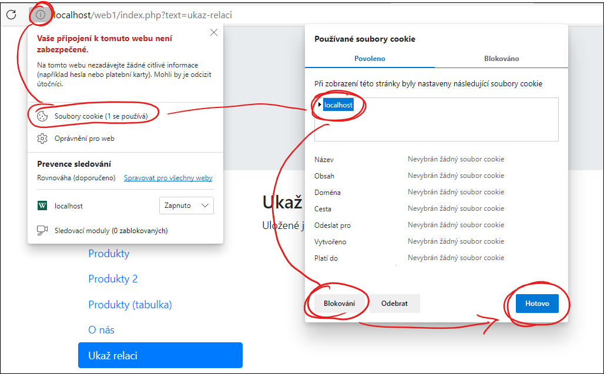

# PHP - Relace (`$_SESSION[]`)

Relace je v podstatě **speciální typ proměnné** `$_SESSION[]`. Vzniká vždy při spojení se serverem, na kterém jsou naše webové stránky umístněné. Na rozdíl od běžných proměnných, které doposud známe a jež se používají (jsou viditelné) pouze při generování jediné stránky, jsou proměnné v relacích dostupné i při přechodu na jiné podstránky webové aplikace. 

```php
/* obsah proměnné $a při skončení skriptu zanikne */
$a = 5;

/* obsah proměnné $b při okončení skriptu nezanikne
zanikne až po opuštění webu */ 
$_SESSION['b'] = 5; 
```

**Dokumentace**: [www.w3schools.com/php/php_sessions.asp](https://www.w3schools.com/php/php_sessions.asp)

V relacích tak můžeme uchovávat informaci o tom, že uživatel se už úspěšně přihlásil (do členské nebo administrační zóny apod.), a nebudeme tak opět vyžadovat přihlášení při přechodu na další podstránku webu. 

V relaci můžeme uchovávat např. informaci o tom, jak se uživatel jmenuje. Možná jste si např. při nákupech v e-shopu všimli, že je někde na stránce napsáno "Přihlášen" či vaše jméno. Právě to zajišťují relace.

Relace mají ovšem nastavenou **platnost do okamžiku zavření okna webového prohlížeče**.  Na rozdíl od cookies se do klientského počítače neukládají samotné informace (proměnné), ale pouze párovací klíč.

Jak přesně relace fungují, si ukážeme na jednoduchém příkladu **Jméno**.

---

**Důležité:** Poté, když je relace otevřena na jiné stránce (to je přesně tento případ), vyhledá se v počítači uživatelský klíč. Pokud je shodný, přistupuje k této relaci, pokud ne, spustí novou relaci. Jinak to nejde, protože **protokol HTTP je bezestavový** -- nedokáže uchovat informace o tom, kdo o stránku požádal, a tudíž jaká data z relace mu má poslat. Musíte si uvědomit, že stejnou stránku si může paralelně otevřít více uživatelů, kde každý z nich bude mít svoji vlastní relaci identifikovanou vlastním unikátním klíčem.

Že to opravdu funguje si můžete ověřit hned třemi způsoby:

1. Spuštěním webu na jiném počítači (např. mobilu),
2. spuštěním webu v anonymním okně prohlížeče: <kbd>Ctrl</kbd>+<kbd>Shift</kbd>+<kbd>N</kbd>, 
3. Zakázáním ukládání cookies (tzn. toho identifikačního klíče): 

<br>*Pozn: Vzhled se může mírně lišit.*


